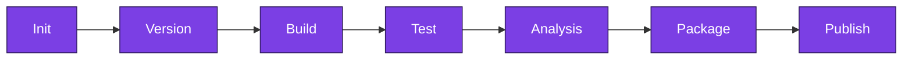

<div align="center">


# ZeroFailed

**Reusable, shareable build & deployment automation for PowerShell 7+.**<br/>
Write your pipeline once. Run it anywhere: on your laptop, in GitHub Actions, in Azure DevOps.

[](https://www.powershellgallery.com/packages/ZeroFailed)
[](https://www.powershellgallery.com/packages/ZeroFailed)
[](https://github.com/zerofailed/ZeroFailed/blob/main/LICENSE)
[](https://learn.microsoft.com/powershell/scripting/install/installing-powershell)
[](#why)

[**Get started**](#get-started) · [**Extensions**](#extensions) · [**Samples**](#samples) · [**AI agent skills**](#ai-agent-skills) · [**Docs**](https://github.com/zerofailed/ZeroFailed#readme)

</div>

---

## 🤔 What is ZeroFailed?

Most teams copy and paste the same build and deployment scripts from repo to repo, then watch them drift apart. **ZeroFailed** turns those scripts into **versioned, composable extensions** that you reference from a small configuration file.

You add two files to a repo. ZeroFailed downloads the extensions you list and runs a tested, opinionated process: **version → build → test → analyse → package → publish**. You change its behaviour with properties and hook in your own steps where you need them.

ZeroFailed is built on the excellent [InvokeBuild](https://github.com/nightroman/Invoke-Build) engine. It runs on PowerShell, so it does not depend on any one CI/CD platform, and it still integrates with them where that helps. The extensions come from processes that have shipped real-world projects.

<a id="why"></a>

## ✨ Why ZeroFailed?

<table>
<tr>
<td width="50%" valign="top">

### 🔁 Same process everywhere
`./build.ps1` runs the same way on your machine and in CI. When the pipeline fails, debug it locally. You do not need to push commits just to test a YAML change.

</td>
<td width="50%" valign="top">

### 🧩 Composable extensions
Combine .NET, Python, PowerShell, container, GitHub, Azure, Fabric and Power BI extensions in one process. Dependencies between extensions resolve automatically.

</td>
</tr>
<tr>
<td valign="top">

### 🎛️ Configure it, don't fork it
Each task reads properties (with `ZF_*` environment-variable overrides) and has `Pre*`/`Post*` hooks. You customise the process without editing shared code.

</td>
<td valign="top">

### 🔒 Reproducible by default
A lock file (`.zf/extensions.lock.json`) records the exact version and content hash of every extension. Use `Frozen` mode in CI to fail the run if anything changes.

</td>
</tr>
<tr>
<td valign="top">

### 📦 Share it your way
Publish extensions to the PowerShell Gallery or a private feed, or reference them straight from a git branch, tag or commit.

</td>
<td valign="top">

### 🤖 Agent-ready
Install the [ZeroFailed skills](#ai-agent-skills) in Claude Code or GitHub Copilot CLI, and your coding agent can configure, troubleshoot and upgrade builds for you.

</td>
</tr>
</table>

<a id="get-started"></a>

## 🚀 Get started in 3 steps

> **Prerequisite:** [PowerShell 7.1 or later](https://learn.microsoft.com/powershell/scripting/install/installing-powershell) on Windows, Linux or macOS.

**1. Add the entry-point script.** Copy `build.ps1` from a [sample repo](#samples) (for example, [the .NET sample](https://github.com/zerofailed/ZeroFailed.Sample.DotNet)). It installs `InvokeBuild` and `ZeroFailed` when you first run it.

**2. Describe your build in `.zf/config.ps1`:**

```powershell
# Choose the extensions that this process uses
$zerofailedExtensions = @(
    @{
        Name          = "ZeroFailed.Build.DotNet"
        GitRepository = "https://github.com/zerofailed/ZeroFailed.Build.DotNet"
        GitRef        = "main"   # or pin a tag or commit
    }
)

# Load the tasks and the process
. ZeroFailed.tasks -ZfPath $here/.zf

# Configure the process for this repo
$SolutionToBuild = "$here/src/MySolution.sln"

# Run the full build by default
task . FullBuild

# Optional: add your own steps at any extensibility point
task PostTest { Write-Build Green "All tests passed!" }
```

**3. Run it locally or in CI:**

```powershell
./build.ps1
```



Every stage has `Pre<Stage>` and `Post<Stage>` hooks, and you can skip any stage with a `$Skip<Stage>` switch. Deployments follow the same pattern: **Init → Provision → Deploy → Test**.

📖 For more detail, read the [ZeroFailed docs](https://github.com/zerofailed/ZeroFailed#readme): extension syntax, version ranges, lock modes and the function reference.

<a id="extensions"></a>

## 🧰 Extension library

<table>
<tr><th>Area</th><th>Extension</th><th>What it gives you</th></tr>
<tr><td rowspan="2">⚙️ <b>Core</b></td>
<td><a href="https://github.com/zerofailed/ZeroFailed"><code>ZeroFailed</code></a></td>
<td>The framework: extension loading, dependency resolution and lock files</td></tr>
<tr><td><a href="https://github.com/zerofailed/ZeroFailed.DevOps.Common"><code>DevOps.Common</code></a></td>
<td>CI/CD server detection, module bootstrapping and build lifecycle hooks</td></tr>

<tr><td rowspan="6">🏗️ <b>Build</b></td>
<td><a href="https://github.com/zerofailed/ZeroFailed.Build.Common"><code>Build.Common</code></a></td>
<td>The standard build process and GitVersion-based versioning</td></tr>
<tr><td><a href="https://github.com/zerofailed/ZeroFailed.Build.DotNet"><code>Build.DotNet</code></a></td>
<td>.NET compile, test with coverage, SBOM generation, and NuGet packaging and publishing (including Trusted Publishing)</td></tr>
<tr><td><a href="https://github.com/zerofailed/ZeroFailed.Build.Python"><code>Build.Python</code></a></td>
<td>Poetry or uv, linting, testing, and building and publishing <code>.whl</code> packages</td></tr>
<tr><td><a href="https://github.com/zerofailed/ZeroFailed.Build.PowerShell"><code>Build.PowerShell</code></a></td>
<td>Pester tests with coverage, PlatyPS docs, and module publishing with PSResourceGet</td></tr>
<tr><td><a href="https://github.com/zerofailed/ZeroFailed.Build.Containers"><code>Build.Containers</code></a></td>
<td>Container image build and publish with the Docker CLI or ACR Tasks</td></tr>
<tr><td><a href="https://github.com/zerofailed/ZeroFailed.Build.GitHub"><code>Build.GitHub</code></a></td>
<td>GitHub Releases, with build artifacts attached</td></tr>

<tr><td rowspan="4">☁️ <b>Deploy</b></td>
<td><a href="https://github.com/zerofailed/ZeroFailed.Deploy.Common"><code>Deploy.Common</code></a></td>
<td>The standard deployment process and environment configuration</td></tr>
<tr><td><a href="https://github.com/zerofailed/ZeroFailed.Deploy.Azure"><code>Deploy.Azure</code></a></td>
<td>ARM and Bicep deployments, App Service and Function App ZIP deploy, temporary firewall access</td></tr>
<tr><td><a href="https://github.com/zerofailed/ZeroFailed.Deploy.Fabric"><code>Deploy.Fabric</code></a></td>
<td>Microsoft Fabric workspaces across DTAP environments: Git integration, identity, RBAC and pipelines</td></tr>
<tr><td><a href="https://github.com/zerofailed/ZeroFailed.Deploy.PowerBI"><code>Deploy.PowerBI</code></a></td>
<td>Power BI and Fabric shared cloud connections and permissions, declared in YAML</td></tr>
</table>

> 💡 **Build your own:** start from the [extension template](https://github.com/zerofailed/ZeroFailed.Extension.Template) to package your team's automation as an extension, then share it internally or publicly.

<a id="samples"></a>

## 🧪 Samples

Clone a working repo and run `./build.ps1`:

| Sample | Shows you how to |
|---|---|
| [**ZeroFailed.Sample.DotNet**](https://github.com/zerofailed/ZeroFailed.Sample.DotNet) | Build, test, package and publish a .NET solution, including multi-target and AOT publishing |
| [**ZeroFailed.Sample.Python**](https://github.com/zerofailed/ZeroFailed.Sample.Python) | Build, lint, test and package a Python project |
| [**ZeroFailed.Sample.PowerBI**](https://github.com/zerofailed/ZeroFailed.Sample.PowerBI) | Manage Power BI connections and permissions as code |

<a id="ai-agent-skills"></a>

## 🤖 AI agent skills

The [**ZeroFailed marketplace**](https://github.com/zerofailed/zerofailed-marketplace) gives your coding agent a skill for each extension. Each skill covers that extension's properties, tasks, gotchas and working config snippets. It also includes skills for writing extensions, setting up GitHub Actions workflows, and upgrading repos to the latest ZeroFailed.

<table>
<tr>
<td><b>Claude Code</b></td>
<td><b>GitHub Copilot CLI</b></td>
</tr>
<tr>
<td>

```shell
/plugin marketplace add zerofailed/zerofailed-marketplace
/plugin install zerofailed-tools@zerofailed
```

</td>
<td>

```shell
copilot plugin marketplace add zerofailed/zerofailed-marketplace
copilot plugin install zerofailed-tools@zerofailed
```

</td>
</tr>
</table>

Then ask your agent questions such as *"Add a Bicep deployment to our deploy process"* or *"Upgrade this repo to the latest ZeroFailed"*.

## 🤝 Get involved

- ⭐ **Star [ZeroFailed](https://github.com/zerofailed/ZeroFailed)** to help other people find it.
- 🐛 **Report a bug or request a feature** in the issues of the related repo.
- 🔧 **Contribute.** We welcome pull requests to the core module, the extensions, the samples and the docs.
- 🧩 **Share an extension.** Have you built one? Tell us in the issues of the [ZeroFailed repo](https://github.com/zerofailed/ZeroFailed/issues).

<div align="center">

---

<sub>All ZeroFailed projects are open source under the <a href="https://github.com/zerofailed/ZeroFailed/blob/main/LICENSE">Apache 2.0 license</a>.<br/>
<b>PowerShell</b> · <b>InvokeBuild</b> · <b>CI/CD</b> · <b>DevOps</b> · <b>build automation</b> · <b>deployment automation</b> · <b>.NET</b> · <b>Python</b> · <b>Azure</b> · <b>Microsoft Fabric</b> · <b>Power BI</b></sub>

</div>
